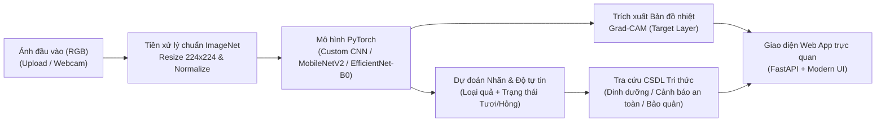

# GIAI ĐOẠN 1: ĐỊNH HÌNH ĐỀ TÀI, HƯỚNG TIẾP CẬN & KIẾN TRÚC MÔ HÌNH
*(Phiên bản v2.0 - Đã được kiểm định chéo và hiệu đính bởi Academic & AI Reviewer)*

## 1. Tên Đề Tài Chính Thức
- **Tiếng Việt:** Nghiên cứu và xây dựng hệ thống phân loại đa lớp kết hợp đánh giá chất lượng (Tươi/Hỏng) hoa quả ứng dụng Học sâu (Deep Learning), Học chuyển giao (Transfer Learning) và AI có thể giải thích (Explainable AI - Grad-CAM).
- **Tiếng Anh:** *Multi-class Fruit Classification and Freshness/Quality Assessment System using Deep Learning, Transfer Learning, and Explainable AI (Grad-CAM).*

---

## 2. Đặt Vấn Đề, Lý Do Chọn Đề Tài & Không Gian Nhãn

### 2.1. Tính cấp thiết trong thực tế
Trong chuỗi cung ứng nông sản, siêu thị bán lẻ và nhà máy chế biến thực phẩm, việc phân loại chủng loại quả đồng thời tách lọc quả tươi đạt chuẩn khỏi quả bị dập/thối hỏng (rotten/spoiled) vẫn phụ thuộc lớn vào nhân công thủ công:
- **Tốn thời gian và chi phí nhân sự**, dễ xảy ra sai sót chủ quan khi làm việc liên tục.
- **Nguy cơ lây nhiễm chéo:** Một quả thối hỏng không được tách kịp thời sẽ phát tán khí ethylene và bào tử nấm mốc làm hỏng cả lô hàng bảo quản xung quanh.
- Các bài toán chỉ phân loại tên quả đơn thuần (như nhận diện Táo hay Chuối trên nền trắng) thiếu tính thực tiễn vì ngoài đời thực, bài toán cốt lõi luôn là kết hợp: **"Đây là quả gì?"** và **"Quả còn tươi đạt chuẩn hay đã hỏng?"**.

### 2.2. Giá trị học thuật & Định nghĩa Không gian nhãn ($C = 2 \times K$ lớp)
1. **Bài toán Phân loại Đa lớp kết hợp Đa thuộc tính (Joint Fruit Type & Freshness Classification):**
   - Gọi $K$ là số chủng loại hoa quả phổ biến và $S = \{\text{Fresh}, \text{Rotten}\}$ là 2 trạng thái chất lượng. Không gian nhãn tổng cộng gồm $C = 2 \times K$ lớp phân biệt.
   - Tổ hợp tiêu chuẩn áp dụng trong dự án ($K = 5 \Rightarrow C = 10$ lớp chuẩn hoặc $K = 3 \Rightarrow C = 6$ lớp tùy cấu hình dataset Kaggle ở Giai đoạn 2):
     - Nhóm Tươi ($\mathcal{Y}_{\text{fresh}}$): `fresh_apple`, `fresh_banana`, `fresh_orange`, `fresh_mango`, `fresh_strawberry` (hoặc tương đương theo bộ dữ liệu thực nghiệm).
     - Nhóm Hỏng ($\mathcal{Y}_{\text{rotten}}$): `rotten_apple`, `rotten_banana`, `rotten_orange`, `rotten_mango`, `rotten_strawberry`.
2. **Thách thức Thị giác máy tính (Computer Vision Challenges):**
   - *Intra-class variation (Biến thiên nội lớp):* Cùng một lớp `rotten_banana` nhưng mức độ thâm đen, đốm nâu, biến dạng hình học rất khác nhau.
   - *Inter-class similarity (Tương đồng liên lớp):* Quả bị hỏng nặng hoặc chụp thiếu sáng dễ bị nhầm lẫn giữa các loại quả có hình khối tròn (Táo hỏng vs Cam hỏng).
3. **Tính giải thích được (Explainable AI - XAI):** Tích hợp **Grad-CAM** để chứng minh mô hình thực sự nhìn vào vết thâm/nấm mốc trên vỏ quả để kết luận "Hỏng" chứ không phải học vẹt phông nền (Background bias).

---

## 3. Hướng Tiếp Cận & Quy Trình Hệ Thống (End-to-End Pipeline)



---

## 4. Lựa Chọn Khung Công Nghệ (Tech Stack)

| Thành phần | Công nghệ lựa chọn | Lý do lựa chọn |
| :--- | :--- | :--- |
| **Deep Learning Framework** | **PyTorch (`torch`, `torchvision`)** | Linh hoạt, kiểm soát vòng lặp huấn luyện/checkpoint trên Colab cực kỳ rõ ràng, trích xuất Grad-CAM qua `forward/backward hook` chính xác và không bị lỗi xung đột phiên bản như Keras `.h5`/`.keras` khi chuyển về máy cá nhân VS Code. |
| **Môi trường Huấn luyện** | **Google Colab (GPU Tesla T4)** + **Google Drive Backup** | Tận dụng GPU miễn phí, kết hợp tự động lưu `best_model.pth`, `last_checkpoint.pth` và `training_history.csv` sang Google Drive sau mỗi epoch. |
| **Backend & Web App (VS Code)** | **FastAPI + HTML5/TailwindCSS/Chart.js** | Giao diện chuyên nghiệp, tốc độ phản hồi cực nhanh, hỗ trợ API chuẩn RESTful, dễ dàng tùy biến giao diện Dashboard so sánh và hiển thị Grad-CAM mượt mà. |

---

## 5. Lựa Chọn 3 Mô Hình So Sánh Thực Nghiệm (Ablation & Comparative Study)

Để báo cáo có phần **Thực nghiệm & Đánh giá** thuyết phục nhất, dự án huấn luyện và đặt lên bàn cân so sánh **3 kiến trúc mạng tích chập (CNN)** đại diện cho 3 trường phái thiết kế:

### 5.1. Mô hình 1: Custom CNN (Baseline - Tự thiết kế từ đầu)
- **Kiến trúc:** 4 khối tích chập (`Conv2d` $3\times3$, padding=1 $\rightarrow$ `BatchNorm2d` $\rightarrow$ `ReLU` $\rightarrow$ `MaxPool2d(2,2)`) với số kênh tăng dần $32 \rightarrow 64 \rightarrow 128 \rightarrow 256$, theo sau bởi `AdaptiveAvgPool2d((1,1))`, `Dropout(0.4)` và bộ phân loại `Linear(256, 128) -> ReLU -> Dropout(0.3) -> Linear(128, C)`. Khởi tạo trọng số bằng phương pháp Kaiming He (`kaiming_normal_`).
- **Vai trò học thuật:** Làm **mốc cơ sở (Baseline)** để chứng minh vai trò của các thành phần cơ bản trong CNN và làm nổi bật hiệu quả của Transfer Learning khi số lượng mẫu huấn luyện có hạn.

### 5.2. Mô hình 2: MobileNetV2 (Transfer Learning - Tối ưu tốc độ & Edge/Web AI)
- **Kiến trúc cốt lõi:** Sử dụng **Inverted Residuals** và **Linear Bottlenecks** cùng phép tích chập tách biệt chiều sâu (**Depthwise Separable Convolution**), giảm số lượng tham số và số phép tính FLOPs đi 8–9 lần so với tích chập tiêu chuẩn.
- **Vai trò học thuật:** Đại diện cho nhóm **Lightweight Model (Mô hình gọn nhẹ)** phục vụ triển khai thời gian thực trên Web App chạy CPU ở máy cá nhân.

### 5.3. Mô hình 3: EfficientNet-B0 (Transfer Learning - Tối ưu độ chính xác với Attention)
- **Kiến trúc cốt lõi:** Sử dụng kỹ thuật **Compound Scaling** (cân bằng đồng thời chiều sâu $d$, chiều rộng $w$ và độ phân giải $r$) kết hợp khối **MBConv (Mobile Inverted Bottleneck)** tích hợp cơ chế chú ý kênh **Squeeze-and-Excitation (SE) Attention**.
- **Vai trò học thuật:** Cơ chế **SE Attention** tự động đánh trọng số cao cho các kênh đặc trưng mang thông tin vùng đốm thối/nấm mốc tinh vi trên bề mặt vỏ quả, giúp đạt độ chính xác (Accuracy & Macro F1) tối đa.

### 5.4. Bảng Tổng Hợp Thông Số Kỹ Thuật Của 3 Mô Hình

| Thông số | 1. Custom CNN (Baseline) | 2. MobileNetV2 | 3. EfficientNet-B0 |
| :--- | :--- | :--- | :--- |
| **Phương thức huấn luyện** | Train from scratch (Kaiming Init) | Transfer Learning (ImageNet-1K) | Transfer Learning (ImageNet-1K) |
| **Kích thước ảnh đầu vào** | $224 \times 224 \times 3$ (RGB) | $224 \times 224 \times 3$ (RGB) | $224 \times 224 \times 3$ (RGB) |
| **Số lượng tham số (~Params)** | ~1.21 Triệu (1,206,886) | ~2.23 Triệu (Backbone + Head) | ~4.02 Triệu (Backbone + Head) |
| **Đặc trưng kiến trúc** | 4 khối Conv tiêu chuẩn + BatchNorm | Inverted Residual + Depthwise Conv | Compound Scaling + MBConv + SE Block |
| **Classifier Head thay thế** | `Dropout(0.4) -> FC(256,128) -> FC(128,C)` | `Dropout(0.3) -> Linear(1280, C)` | `Dropout(0.3) -> Linear(1280, C)` |
| **Tầng trích xuất Grad-CAM (`target_layer`)** | `model.features[-1]` (Khối Conv4 - 256 kênh) | `model.features[-1]` (`Conv2dNormActivation` - 1280 kênh) | `model.features[-1]` (`Conv2dNormActivation` - 1280 kênh) |

---

## 6. Chiến Lược Huấn Luyện, Hàm Mất Mát & Chống Quá Khớp

### 6.1. Chiến lược Huấn luyện 2 Pha (Two-Stage Fine-Tuning cho MobileNetV2 & EfficientNet-B0)
Để tránh hiện tượng phá vỡ các đặc trưng thị giác đã học từ ImageNet (*Catastrophic Forgetting*), quá trình huấn luyện được chia làm 2 pha chặt chẽ:
1. **Pha 1 - Warm-up Classifier Head (5 Epochs):**
   - Đóng băng toàn bộ trọng số Backbone (`param.requires_grad = False`).
   - **Lưu ý kỹ thuật BatchNorm:** Giữ các tầng `BatchNorm2d` trong Backbone ở chế độ `.eval()` trong suốt Pha 1 để không làm lệch thống kê `running_mean` và `running_var` của ImageNet.
   - Chỉ huấn luyện Classifier Head với bộ tối ưu `AdamW(lr=1e-3, weight_decay=1e-4)`.
2. **Pha 2 - Deep Fine-Tuning (15–20 Epochs):**
   - Mở khóa các khối cuối của Backbone (`features[-4:]` hoặc toàn bộ mạng) với **Differential Learning Rates**: `lr_backbone = 1e-4`, `lr_head = 5e-4`, `weight_decay = 1e-4`.
   - Điều chỉnh tốc độ học tự động bằng `CosineAnnealingLR` (hoặc `ReduceLROnPlateau` theo `val_loss`).

### 6.2. Hàm Mất Mát (Loss Function) & Cơ chế Early Stopping
- **Hàm mất mát:** Sử dụng **Weighted Cross-Entropy Loss kết hợp Label Smoothing ($\epsilon = 0.1$)**:
  $$\mathcal{L}_{\text{CE-LS}}(y, \hat{p}) = -\sum_{c=1}^{C} w_c \cdot \tilde{y}_c \log(\hat{p}_c), \quad \text{với } \tilde{y}_c = (1 - \epsilon)\mathbb{I}(y = c) + \frac{\epsilon}{C}$$
  Trong đó $w_c$ là trọng số cân bằng lớp (tính nghịch đảo tần suất xuất hiện trên tập Train) và $\epsilon = 0.1$ giúp ngăn mô hình quá tự tin cực đoan (Overconfidence), giúp xác suất Top-3 trên Web App mượt và thực tế hơn.
- **Early Stopping:** Dừng sớm nếu `val_macro_f1` không cải thiện sau `patience = 5` epochs liên tiếp, luôn khôi phục trọng số tại epoch có `val_macro_f1` cao nhất.

---

## 7. Bộ Chỉ Số Đánh Giá Toàn Diện & Công Thức Toán Học

Gọi $M \in \mathbb{N}^{C \times C}$ là ma trận nhầm lẫn trên tập kiểm thử (Test set), trong đó $M_{i,j}$ là số mẫu thuộc lớp thực tế $i$ được mô hình dự đoán vào lớp $j$:

1. **Overall Accuracy (%):**
   $$\text{Accuracy} = \frac{\sum_{i=1}^{C} M_{i,i}}{\sum_{i=1}^{C}\sum_{j=1}^{C} M_{i,j}} \times 100\%$$

2. **Macro Precision, Macro Recall và Macro F1-Score:**
   $$\text{Precision}_i = \frac{M_{i,i}}{\sum_{k=1}^{C} M_{k,i}}, \quad \text{Recall}_i = \frac{M_{i,i}}{\sum_{k=1}^{C} M_{i,k}}, \quad \text{Macro-F1} = \frac{1}{C}\sum_{i=1}^{C} \frac{2 \cdot \text{Precision}_i \cdot \text{Recall}_i}{\text{Precision}_i + \text{Recall}_i}$$

3. **False Safe Rate (FSR - Tỷ lệ bỏ lọt quả hỏng thành quả tươi):**
   Đây là chỉ số an toàn thực phẩm quan trọng nhất. Gọi $\mathcal{Y}_{\text{fresh}}$ là tập chỉ số các lớp quả Tươi và $\mathcal{Y}_{\text{rotten}}$ là tập chỉ số các lớp quả Hỏng:
   $$\text{FSR} = \frac{\sum_{i \in \mathcal{Y}_{\text{rotten}}} \sum_{j \in \mathcal{Y}_{\text{fresh}}} M_{i,j}}{\sum_{i \in \mathcal{Y}_{\text{rotten}}} \sum_{j=1}^{C} M_{i,j}} \times 100\%$$
   *(Mô hình tốt nhất phải có $\text{FSR} \to 0\%$ để không cho phép quả thối hỏng lọt vào dây chuyền tiêu thụ).*

4. **False Rejection Rate (FRR - Tỷ lệ loại nhầm quả tươi thành quả hỏng):**
   Chỉ số đánh giá hao hụt kinh tế do loại bỏ nhầm nông sản còn tốt:
   $$\text{FRR} = \frac{\sum_{i \in \mathcal{Y}_{\text{fresh}}} \sum_{j \in \mathcal{Y}_{\text{rotten}}} M_{i,j}}{\sum_{i \in \mathcal{Y}_{\text{fresh}}} \sum_{j=1}^{C} M_{i,j}} \times 100\%$$

5. **Hiệu năng Hệ thống (System Efficiency Metrics):**
   - **Model File Size (MB)** và **Total / Trainable Parameters**.
   - **Inference Latency (ms/ảnh):** Đo thời gian suy luận trung bình trên cả GPU Colab (T4) và CPU máy cá nhân (VS Code).

---

## 8. Quy Chuẩn Đóng Gói Trọng Số & Tương Thích Đa Môi Trường (Colab GPU $\leftrightarrow$ Windows CPU VS Code)

Để đảm bảo quá trình chuyển giao mô hình từ Google Colab về chạy Web App trên VS Code (Windows CPU) đạt độ ổn định 100%, dự án áp dụng 4 quy tắc kỹ thuật bắt buộc:

1. **Chuẩn gói lưu trữ tự thân (Self-Contained Checkpoint Schema `.pth`):**
   Mọi file trọng số xuất ra từ Colab phải được đóng gói dưới dạng Python `dict` chứa đầy đủ siêu dữ liệu:
   ```python
   checkpoint = {
       "arch_name": "efficientnet_b0",          # 'custom_cnn' | 'mobilenet_v2' | 'efficientnet_b0'
       "num_classes": num_classes,
       "class_names": class_names,              # Danh sách tên lớp theo đúng thứ tự index
       "class_to_idx": class_to_idx,
       "idx_to_class": idx_to_class,
       "img_size": 224,
       "norm_mean": [0.485, 0.456, 0.406],
       "norm_std": [0.229, 0.224, 0.225],
       "model_state_dict": model.state_dict(),  # Trọng số mô hình
       "best_epoch": epoch,
       "best_val_acc": val_acc,
       "best_val_f1": val_f1,
       "test_metrics": test_metrics_dict
   }
   ```
2. **Tải mô hình an toàn không phụ thuộc CUDA (`Device-Agnostic Loading`):**
   Trên VS Code (Windows), luôn sử dụng `device = torch.device("cuda" if torch.cuda.is_available() else "cpu")` và tải bằng `torch.load(ckpt_path, map_location=device, weights_only=False)`.
3. **Đồng bộ tuyệt đối Không gian màu và Phép biến đổi ảnh:**
   Cả Colab và Web App đều đọc ảnh qua `PIL.Image.open(path).convert("RGB")`, resize về $224 \times 224$ và chuẩn hóa với đúng `norm_mean`, `norm_std` lấy trực tiếp từ trong file `.pth`.
4. **Cơ chế Hook Grad-CAM an toàn bộ nhớ (Memory-Safe Context Manager):**
   Trên FastAPI, mỗi lần trích xuất bản đồ nhiệt Grad-CAM trên `target_layer`, các `forward_hook` và `backward_hook` phải được đặt trong khối `try ... finally: hook.remove()` để giải phóng bộ nhớ ngay lập tức sau mỗi request.
