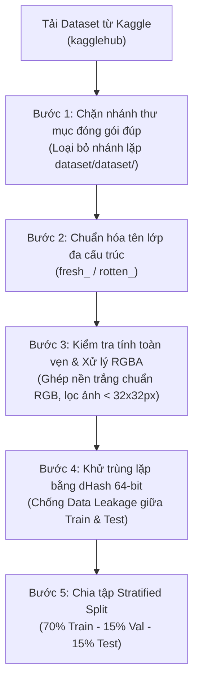

# GIAI ĐOẠN 2: LỰA CHỌN DATASET, PHÂN TÍCH KHÁM PHÁ (EDA) & TIỀN XỬ LÝ DỮ LIỆU
*(Phiên bản v2.0 - Đã được kiểm định chéo và hiệu đính bởi Academic & AI Reviewer)*

## 1. Lựa Chọn Bộ Dữ Liệu Chuẩn Trên Kaggle & Lý Do Học Thuật

### 1.1. Bộ dữ liệu chính & Bộ dữ liệu mở rộng trên Kaggle
Để giải quyết bài toán **Phân loại đa lớp kết hợp đánh giá chất lượng (Fresh vs. Rotten Fruits)** và đảm bảo tải tự động 100% trên Google Colab thông qua thư viện `kagglehub` (không cần cấu hình thủ công API key phức tạp), dự án sử dụng hệ thống nạp dữ liệu hỗ trợ 2 chế độ:

| Chế độ Dataset | Kaggle Dataset Slug (`kagglehub`) | Số lớp ($C$) | Quy mô (~Số ảnh) | Đặc điểm & Vai trò |
| :--- | :--- | :---: | :---: | :--- |
| **Option 1 (Mặc định - Đa dạng 10/12 lớp)** | `swoyam2609/fresh-and-stale-classification` *(hoặc `raghavrpotdar/fresh-and-rotten-fruits-images`)* | **10 – 12 lớp** (`Fresh/Rotten` $\times$ `Apple, Banana, Orange, Mango/Bittergourd, Strawberry/Capsicum...`) | `~10.000 – 14.000` ảnh | Đa dạng chủng loại, bao gồm cả quả tròn nhẵn, quả dài và quả có bề mặt sần; thời gian train trên Colab T4 ~25 phút. |
| **Option 2 (Chuẩn Benchmark - 6 lớp)** | `sriramr/fruits-fresh-and-rotten-for-classification` | **6 lớp** (`fresh_apple`, `rotten_apple`, `fresh_banana`, `rotten_banana`, `fresh_orange`, `rotten_orange`) | `~13.599` ảnh | Bộ dữ liệu Benchmark kinh điển được trích dẫn nhiều nhất trong các bài báo khoa học về Freshness Assessment. |

> [!TIP]
> **Cơ chế Chuẩn hóa Nhãn Đa cấu trúc (`Auto-Label Normalizer`):**
> Trên Kaggle, các tác giả thường đặt tên thư mục không đồng nhất: kiểu tiền tố (`freshapples`, `Fresh_Apple`, `stale_orange`), kiểu hậu tố (`apple_fresh`, `banana_rotten`) hoặc cấu trúc thư mục 2 cấp (`Fresh/Apple/img.jpg`). Module [`src/data_pipeline.py`](file:///e:/BTL_PLHoa_qua/src/data_pipeline.py) tự động nhận diện cả 3 kiểu cấu trúc này và chuẩn hóa về định dạng snake_case duy nhất: `fresh_<fruit>` và `rotten_<fruit>`.

---

## 2. Quy Trình Làm Sạch Dữ Liệu & Chống Rò Rỉ (Data Cleaning & Leakage Prevention)

Một điểm yếu phổ biến của các đồ án sinh viên là lấy nguyên thư mục `train` và `test` có sẵn trên Kaggle mà không kiểm tra **nhánh thư mục bị đóng gói đúp**, **ảnh trùng lặp (Duplicate/Near-duplicate images)** hoặc **ảnh lỗi kênh màu**. Để đạt chuẩn học thuật cao nhất, Giai đoạn 2 thực hiện quy trình 5 bước làm sạch nghiêm ngặt:



### 2.1. Kiểm tra tính toàn vẹn & Xử lý kênh trong suốt (RGBA $\rightarrow$ RGB)
- Nhiều ảnh hoa quả trên Kaggle được lưu dưới định dạng `.png` có kênh trong suốt (`RGBA` hoặc `P` - Palette). Nếu chỉ gọi lệnh `img.convert("RGB")` thông thường của PIL, vùng nền trong suốt (`Alpha = 0`) có thể bị biến thành các mảng pixel đen hoặc nhiễu màu bất thường, làm sai lệch bộ lọc tích chập.
- **Giải pháp kỹ thuật:** Hàm [`load_rgb_image_safe`](file:///e:/BTL_PLHoa_qua/src/data_pipeline.py#L99-L111) kiểm tra nếu `img.mode in ("RGBA", "LA") or (img.mode == "P" and "transparency" in img.info)`, hệ thống sẽ tạo một tấm nền trắng chuẩn `(255, 255, 255)` và dán ảnh lên qua `alpha_composite` trước khi chuyển về `RGB`.

### 2.2. Lọc nhánh thư mục đóng gói đúp & Chống Rò rỉ Dữ liệu bằng Difference Hash (`dHash`)
- **Xử lý lỗi đóng gói đúp (`dataset/dataset/`):** Trong bộ dữ liệu Kaggle `sriramr/fruits-fresh-and-rotten-for-classification`, tác giả gốc đóng gói bị lặp một thư mục con `dataset/dataset/` bên trong `dataset/`, làm nhân đôi số file vật lý. Hàm [`scan_and_clean_dataset`](file:///e:/BTL_PLHoa_qua/src/data_pipeline.py#L148-L246) tự động phát hiện và loại bỏ nhánh thư mục lặp này ngay từ bước duyệt cây thư mục để số liệu thống kê làm sạch (`total_scanned`, `duplicates_removed`) hoàn toàn trung thực.
- **Khử trùng lặp thị giác bằng `dHash` 64-bit:** Gom toàn bộ ảnh hợp lệ vào một kho duy nhất (Unified Pool), tính mã băm thị giác **Difference Hash (`dHash` 64-bit)** trên lưới xám $9 \times 8$ để loại bỏ triệt để các bản sao xuất hiện trùng lặp giữa thư mục `train` và `test` gốc trước khi chia tập.

---

## 3. Chiến Lược Chia Tập Dữ Liệu (Stratified Train / Val / Test Split)

Sau khi làm sạch và khử trùng lặp, toàn bộ tập dữ liệu $\mathcal{D}$ được chia thành 3 tập độc lập hoàn toàn bằng thuật toán **Stratified Shuffle Split** (`random_state = 42`):

| Tập dữ liệu | Tỷ lệ (%) | Mục đích sử dụng | Áp dụng Data Augmentation? |
| :--- | :---: | :--- | :---: |
| **Training Set ($\mathcal{D}_{\text{train}}$)** | **70%** | Tối ưu hóa trọng số mạng qua lan truyền ngược (Backpropagation). | **Có** (Online Augmentation mỗi epoch) |
| **Validation Set ($\mathcal{D}_{\text{val}}$)** | **15%** | Tinh chỉnh siêu tham số, điều khiển `ReduceLROnPlateau`, `EarlyStopping` và chọn `best_model.pth`. | **Không** (Chỉ Resize + Normalize) |
| **Test Set ($\mathcal{D}_{\text{test}}$)** | **15%** | Đánh giá độc lập cuối cùng (Accuracy, Macro-F1, FSR, FRR, Confusion Matrix). Tuyệt đối không dùng trong lúc train. | **Không** (Chỉ Resize + Normalize) |

Toàn bộ danh sách đường dẫn ảnh, nhãn gốc, trạng thái (`fresh`/`rotten`), loại quả và tập phân chia (`train`/`val`/`test`) được xuất ra file `dataset_split_manifest.csv` để đảm bảo **tính tái lập thực nghiệm (Reproducibility) 100%** giữa các lần chạy.

---

## 4. Phân Tích Khám Phá Dữ Liệu (EDA) - Bộ 6 Biểu Đồ Trực Quan Hóa "Trước Khi Train"

Module [`src/data_pipeline.py`](file:///e:/BTL_PLHoa_qua/src/data_pipeline.py) tự động trích xuất và lưu **6 biểu đồ chất lượng cao (300 DPI)** vào thư mục `reports/figures/` để đưa thẳng vào Chương 3 của Báo cáo:

1. **`01_class_distribution.png` (Phân phối số lượng mẫu theo lớp & Tỷ lệ Fresh vs. Rotten):**
   - Biểu đồ cột ngang hiển thị số lượng ảnh chính xác và tỷ lệ phần trăm của từng lớp.
   - Biểu đồ tròn đối chiếu tổng lượng mẫu nhóm **Tươi ($\mathcal{Y}_{\text{fresh}}$)** so với nhóm **Hỏng ($\mathcal{Y}_{\text{rotten}}$)**, kèm chỉ số mất cân bằng $\text{Imbalance Ratio (IR)} = \frac{N_{\max}}{N_{\min}}$.
2. **`02_stratified_split_verification.png` (Kiểm chứng phân phối Train / Val / Test):**
   - Biểu đồ cột chồng xác nhận tỷ lệ 70% - 15% - 15% được giữ nguyên đồng đều trên tất cả $C$ lớp.
3. **`03_image_dimensions_analysis.png` (Phân tích kích thước gốc & Tỷ lệ khung hình):**
   - Biểu đồ phân tán (Scatter Plot) của Chiều rộng (Width) $\times$ Chiều cao (Height) và Histogram tỷ lệ khung hình ($\text{Aspect Ratio} = W / H$).
   - **Ý nghĩa học thuật trong báo cáo:** Chứng minh hầu hết ảnh có tỷ lệ xấp xỉ $1:1$ ($\text{AR} \in [0.8, 1.25]$), từ đó bảo vệ quyết định resize về $224 \times 224$ mà không làm biến dạng hình học nghiêm trọng của quả.
4. **`04_raw_samples_comparison.png` (Lưới ảnh mẫu đối chứng Tươi vs. Hỏng):**
   - Hiển thị trực quan từng loại quả ở 2 trạng thái `Fresh` (hàng trên) và `Rotten` (hàng dưới) kèm kích thước gốc.
5. **`05_fresh_vs_rotten_color_profile.png` (Phân tích phổ màu RGB & Độ sáng trên Vùng Tiền Cảnh Quả):**
   - Áp dụng kỹ thuật **Tách pixel tiền cảnh (Foreground Pixel Masking)**: loại bỏ các pixel phông nền trắng studio ($R > 0.94 \land G > 0.94 \land B > 0.94$) trước khi tính cường độ sáng và trung bình kênh màu R-G-B.
   - **Ý nghĩa học thuật:** Khi không bị phông nền trắng làm nhiễu, biểu đồ thể hiện cực kỳ rõ nét sự suy giảm cường độ sáng và sự dịch chuyển sắc tố đỏ/vàng (browning/oxidation) ở nhóm quả Hỏng so với quả Tươi.
6. **`06_augmentation_pipeline_preview.png` (Trực quan hóa Pipeline Tăng cường Dữ liệu):**
   - Hiển thị 1 ảnh gốc và 7 biến thể sinh ra ngẫu nhiên qua đúng pipeline Augmentation thực tế lúc huấn luyện.

---

## 5. Thiết Kế Pipeline Tiền Xử Lý & Tăng Cường Dữ Liệu (Data Augmentation)

### 5.1. Nguyên tắc Bảo toàn Ngữ nghĩa Chất lượng (Label-Preserving Augmentation)
> [!IMPORTANT]
> **Hai nguyên tắc cốt lõi khi Augmentation cho bài toán Đánh giá độ tươi/hỏng:**
> 1. **Kiểm soát biến đổi màu (`hue=0.02`):** Màu sắc và độ tương phản bề mặt là dấu hiệu cốt lõi để phân biệt quả tươi với quả thối hỏng. Nếu đặt `hue` lớn, quả táo đỏ tươi sẽ bị đổi màu thành tím/nâu giống quả hỏng (gây *Label Noise*). Do đó ta giới hạn `brightness=0.15, contrast=0.15, saturation=0.15, hue=0.02`.
> 2. **Tránh tạo góc đen giả tạo khi xoay ảnh (`fill=(255, 255, 255)`):** Khi áp dụng `RandomRotation(degrees=20)`, nếu để mặc định `fill=0`, 4 góc ảnh sẽ xuất hiện 4 tam giác màu đen tuyền — dễ gây nhầm lẫn với mảng thối đen trên ảnh nền trắng. Vì vậy ta đặt `fill=(255, 255, 255)` để lấp góc xoay bằng màu nền sáng tự nhiên.

### 5.2. Chi tiết Phép biến đổi trên Tập Train và Tập Val/Test

```python
# 1. Transform cho tập Train (Online Data Augmentation)
train_transform = transforms.Compose([
    transforms.Resize((256, 256)),
    transforms.RandomRotation(degrees=20, fill=(255, 255, 255)),
    transforms.RandomResizedCrop(224, scale=(0.80, 1.0), ratio=(0.90, 1.10)),
    transforms.RandomHorizontalFlip(p=0.5),
    transforms.RandomVerticalFlip(p=0.2),
    transforms.ColorJitter(brightness=0.15, contrast=0.15, saturation=0.15, hue=0.02),
    transforms.ToTensor(),
    transforms.Normalize(mean=[0.485, 0.456, 0.406], std=[0.229, 0.224, 0.225]),
    transforms.RandomErasing(p=0.15, scale=(0.02, 0.10), value='random')
])

# 2. Transform cho tập Validation, Test và Web App Inference (Deterministic)
eval_transform = transforms.Compose([
    transforms.Resize((224, 224)),
    transforms.ToTensor(),
    transforms.Normalize(mean=[0.485, 0.456, 0.406], std=[0.229, 0.224, 0.225])
])
```

---

## 6. Xử Lý Mất Cân Bằng Dữ Liệu (Class Imbalance Handling) & Nguyên Tắc Chống Phạt Kép

Khi tỷ lệ mất cân bằng giữa lớp nhiều mẫu nhất và lớp ít mẫu nhất $\text{IR} = \frac{N_{\max}}{N_{\min}} > 1.2$, hệ thống cung cấp 2 cơ chế xử lý nhưng tuân thủ nghiêm ngặt nguyên tắc **Loại trừ lẫn nhau (Mutual Exclusivity)** để tránh hiện tượng phạt kép bậc hai $\propto (1/n_c)^2$:

1. **Phương pháp chính (Mặc định trong Giai đoạn 3 - `use_weighted_sampler=False`):**
   - Giữ nguyên `shuffle=True` trên `DataLoader` để mô hình duyệt qua 100% mẫu dữ liệu ở mỗi epoch.
   - Đưa trọng số lớp cân bằng $w_c = \frac{N_{\text{train}}}{C \cdot n_c}$ vào hàm mất mát `nn.CrossEntropyLoss(weight=class_weights, label_smoothing=0.1)`.
2. **Phương pháp thay thế (Khi thử nghiệm Oversampling - `use_weighted_sampler=True`):**
   - Bật `WeightedRandomSampler` trên `DataLoader` và tự động đặt `weight=None` trong `CrossEntropyLoss`.
