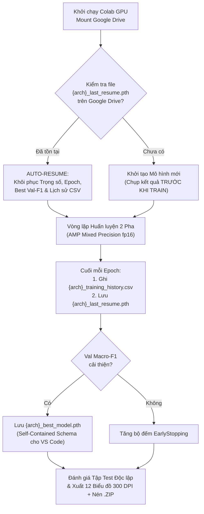

# GIAI ĐOẠN 3: HUẤN LUYỆN TRÊN GOOGLE COLAB (CÓ SAO LƯU TỰ ĐỘNG) & TRỰC QUAN HÓA TRƯỚC/SAU KHI TRAIN

## 1. Kiến Trúc Huấn Luyện Chịu Lỗi (Fault-Tolerant Training & Auto-Resume) Trên Google Colab

Khi huấn luyện 3 mô hình Học sâu (`Custom CNN`, `MobileNetV2`, `EfficientNet-B0`) trên Google Colab GPU miễn phí (Tesla T4), rủi ro lớn nhất là phiên làm việc bị ngắt kết nối đột ngột (Colab Timeout / Disconnect). Do đó, hệ thống tại [`src/trainer_and_eval.py`](file:///e:/BTL_PLHoa_qua/src/trainer_and_eval.py) và Notebook [`notebooks/Colab_Training_Fruit_Classification.ipynb`](file:///e:/BTL_PLHoa_qua/notebooks/Colab_Training_Fruit_Classification.ipynb) được thiết kế theo cơ chế **Sao lưu Thời gian thực sang Google Drive (Real-Time Drive Sync)**:

### 1.1. Ba lớp tệp tin sao lưu tự động trên Google Drive (`/content/drive/MyDrive/BTL_PLHoa_qua_Backup/`)
1. **`{arch}_last_resume.pth` (Checkpoint khôi phục phiên):**
   - Được ghi đè sau **mỗi epoch**. Lưu trạng thái `epoch`, `stage`, `model_state_dict`, `best_val_f1`, `epochs_no_improve`, `history_records`.
   - Nếu Colab bị ngắt kết nối ở Epoch 11/17, khi mở lại Colab và bấm **Run All**, hệ thống tự động phát hiện và chạy tiếp từ **Epoch 12/17** mà không mất một giây huấn luyện nào trước đó.
2. **`{arch}_best_model.pth` (Trọng số tốt nhất chuẩn Self-Contained):**
   - Chỉ cập nhật khi chỉ số **`val_macro_f1`** đạt đỉnh mới.
   - Đóng gói trọng số ở dạng CPU (`v.detach().cpu()`) kèm đầy đủ từ điển ánh xạ `class_to_idx`, `idx_to_class`, `norm_mean`, `norm_std`, `test_metrics` để tải thẳng về thư mục `e:\BTL_PLHoa_qua\models\` chạy Web App trên VS Code.
3. **`{arch}_training_history.csv` (Nhật ký số liệu từng Epoch):**
   - Lưu tức thời `epoch, stage, train_loss, val_loss, train_acc, val_acc, val_macro_f1, val_fsr_percent, lr, elapsed_sec` phục vụ vẽ biểu đồ và chèn bảng số liệu vào báo cáo.

---

## 2. Thiết Lập Siêu Tham Số Huấn Luyện (Hyperparameter Configuration)

| Siêu tham số (Hyperparameter) | Custom CNN (Baseline) | MobileNetV2 (Transfer Learning) | EfficientNet-B0 (Transfer Learning) |
| :--- | :--- | :--- | :--- |
| **Khởi tạo trọng số** | Kaiming Normal (Train from scratch) | ImageNet-1K (`IMAGENET1K_V1`) | ImageNet-1K (`IMAGENET1K_V1`) |
| **Pha 1 (Warm-up Classifier Head)** | Không tách pha (Train toàn mạng) | **5 Epochs** (Freeze Backbone + giữ `BatchNorm2d.eval()`, `lr = 1e-3`) | **5 Epochs** (Freeze Backbone + giữ `BatchNorm2d.eval()`, `lr = 1e-3`) |
| **Pha 2 (Deep Fine-Tuning)** | **17 Epochs** (`lr = 1e-3 -> 1e-5`) | **12 Epochs** (Unfreeze 5 khối cuối, `lr_backbone = 1e-4`, `lr_head = 5e-4`) | **12 Epochs** (Unfreeze 5 khối cuối, `lr_backbone = 1e-4`, `lr_head = 5e-4`) |
| **Bộ tối ưu & Lịch trình LR** | `AdamW(weight_decay=1e-4)` + `CosineAnnealingLR` | `AdamW(weight_decay=1e-4)` + `CosineAnnealingLR` | `AdamW(weight_decay=1e-4)` + `CosineAnnealingLR` |
| **Hàm mất mát (Loss Function)** | `CrossEntropyLoss(weight=class_weights, label_smoothing=0.1)` | `CrossEntropyLoss(weight=class_weights, label_smoothing=0.1)` | `CrossEntropyLoss(weight=class_weights, label_smoothing=0.1)` |
| **Tăng tốc phần cứng** | Mixed Precision (`torch.amp.autocast('cuda')`) | Mixed Precision (`torch.amp.autocast('cuda')`) | Mixed Precision (`torch.amp.autocast('cuda')`) |
| **Early Stopping** | `patience = 5` theo `val_macro_f1` | `patience = 5` theo `val_macro_f1` (chỉ tính ở Pha 2) | `patience = 5` theo `val_macro_f1` (chỉ tính ở Pha 2) |

---

## 3. Danh Mục 12 Biểu Đồ Trực Quan Hóa "Trước & Sau Khi Train" (300 DPI Cho Báo Cáo)

Toàn bộ hình ảnh được xuất tự động ở độ phân giải in ấn **300 DPI** vào thư mục `reports/figures/` và sao lưu lên Google Drive:

### Nhóm A: Trực Quan Hóa Dữ Liệu & Đối Chứng TRƯỚC Khi Train (Hình 01 $\rightarrow$ Hình 07)
1. **`01_class_distribution.png`:** Phân phối số lượng mẫu theo lớp và tỷ lệ `Fresh` vs. `Rotten` kèm chỉ số mất cân bằng $\text{Imbalance Ratio (IR)}$.
2. **`02_stratified_split_verification.png`:** Biểu đồ kiểm chứng tỷ lệ chia tập Stratified Split (70% Train – 15% Val – 15% Test).
3. **`03_image_dimensions_analysis.png`:** Phân tích kích thước ảnh gốc (Width $\times$ Height) và phân phối tỷ lệ khung hình ($\text{Aspect Ratio}$).
4. **`04_raw_samples_comparison.png`:** Lưới ảnh mẫu đối chứng trực quan giữa các loại quả ở trạng thái Tươi và Hỏng.
5. **`05_fresh_vs_rotten_color_profile.png`:** Phân tích phổ màu R-G-B và độ sáng trên vùng tiền cảnh quả (đã tách nền trắng studio).
6. **`06_augmentation_pipeline_preview.png`:** Minh họa 1 ảnh gốc và 7 biến thể qua bộ lọc Data Augmentation.
7. **`07_before_vs_after_training_predictions.png` (Điểm nhấn đối chứng Trước & Sau khi Train):**
   - Chụp kết quả dự đoán và bản đồ nhiệt Grad-CAM trên cùng 4 mẫu ảnh kiểm thử tại 2 thời điểm:
     - **Trước khi huấn luyện (Untrained Classifier):** Xác suất dự đoán phân bố ngẫu nhiên (~10–20%), dự đoán sai nhãn và bản đồ nhiệt Grad-CAM bị tán xạ khắp phông nền.
     - **Sau khi huấn luyện (Fine-tuned Model):** Độ tự tin đạt >95% đúng nhãn thực tế, bản đồ nhiệt Grad-CAM hội tụ chính xác vào bề mặt quả và vùng vết thối/nấm mốc.

### Nhóm B: Trực Quan Hóa Kết Quả Thực Nghiệm SAU Khi Train (Hình 08 $\rightarrow$ Hình 12)
8. **`08_training_curves_3models.png`:** Đường cong `Train/Val Loss`, `Train/Val Accuracy` và `Val Macro-F1` của cả 3 mô hình qua từng epoch, có đường gióng phân tách giữa **Stage 1 (Warm-up)** và **Stage 2 (Fine-tuning)** cùng điểm đánh dấu **Best Checkpoint**.
9. **`09_confusion_matrices_comparison.png`:** Cặp Ma trận nhầm lẫn (Confusion Matrix) trên tập Test độc lập gồm bản **Số lượng mẫu tuyệt đối** và bản **Chuẩn hóa phần trăm (%)**.
10. **`10_per_class_classification_report.png`:** Biểu đồ nhiệt (Heatmap) hiển thị chi tiết `Precision (%)`, `Recall (%)`, `F1-Score (%)` và `Support` của từng lớp quả, kèm file `per_class_classification_report.csv`.
11. **`11_ablation_model_comparison.png`:** Biểu đồ cột so sánh toàn diện 3 kiến trúc (`Custom CNN`, `MobileNetV2`, `EfficientNet-B0`) về:
    - Độ chính xác (`Test Accuracy %`), `Macro F1-Score (%)` và **Tỷ lệ bỏ lọt quả hỏng (`False Safe Rate - FSR %`)**.
    - Tốc độ suy luận thực tế trên CPU (`CPU Latency ms/img`) và Dung lượng trọng số (`Model Size MB`).
12. **`12_gradcam_correct_and_errors.png`:** Lưới giải thích mô hình bằng **Grad-CAM** cho 4 ca dự đoán Đúng tiêu biểu (hàng trên) và 4 ca Nhầm lẫn/Khó nhất (**Error Analysis** - hàng dưới) để bàn luận nguyên nhân sai số trong Chương 4 của Báo cáo.

---

## 4. Hướng Dẫn Chạy Notebook Trên Google Colab & Tải Trọng Số Về VS Code

1. Mở [Google Colab](https://colab.research.google.com/), chọn **Upload** và tải lên file [`notebooks/Colab_Training_Fruit_Classification.ipynb`](file:///e:/BTL_PLHoa_qua/notebooks/Colab_Training_Fruit_Classification.ipynb).
2. Trên thanh menu Colab, chọn **Runtime $\rightarrow$ Change runtime type $\rightarrow$ T4 GPU**.
3. Nhấn **Runtime $\rightarrow$ Run all** (Chạy tất cả):
   - Ở Cell 1, cấp quyền kết nối **Google Drive** để kích hoạt thư mục sao lưu `/content/drive/MyDrive/BTL_PLHoa_qua_Backup`.
   - Toàn bộ quá trình tải dữ liệu Kaggle, làm sạch, xuất 6 biểu đồ EDA, huấn luyện 3 mô hình và xuất 6 biểu đồ đánh giá sau train sẽ diễn ra tự động (~25–35 phút).
4. Ở Cell cuối cùng, Notebook sẽ tự động nén gói kết quả `BTL_Colab_Results_Bundle.zip` (gồm các file `models/*_best_model.pth` và trọn bộ 12 biểu đồ 300 DPI + bảng CSV). Bạn chỉ cần giải nén vào thư mục `e:\BTL_PLHoa_qua` trên VS Code để chạy ngay Web App ở Giai đoạn 4!
