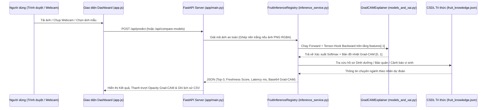

# GIAI ĐOẠN 4: CẤU TRÚC THƯ MỤC HOÀN CHỈNH TRÊN VS CODE & XÂY DỰNG ỨNG DỤNG WEB (FASTAPI + GRAD-CAM XAI)

## 1. Kiến Trúc Thư Mục Chuẩn Kỹ Thuật Phần Mềm (`e:\BTL_PLHoa_qua`)

Toàn bộ dự án trên VS Code được tổ chức theo mô hình phân tầng rõ ràng (Separation of Concerns), tách biệt hoàn toàn giữa **Lõi AI (`src/`)**, **Dịch vụ Web (`app/`)**, **Huấn luyện Colab (`notebooks/`)** và **Hồ sơ Báo cáo (`docs/`, `reports/`)**:

```text
e:\BTL_PLHoa_qua\
├── .vscode\
│   ├── launch.json               # Nhấn F5 trên VS Code để chạy/Debug FastAPI Server
│   └── tasks.json                # Bảng lệnh tự động (Install, Init Demo, Run Server)
├── app\                          # Mã nguồn Ứng dụng Web Thực tế
│   ├── __init__.py
│   ├── main.py                   # FastAPI Backend & 7 RESTful Endpoints
│   ├── inference_service.py      # Bộ quản lý 3 mô hình (Thread-safe), tính Grad-CAM & Top-3
│   ├── fruit_knowledge.json      # CSDL Dinh dưỡng, Nhiệt độ bảo quản & Cảnh báo an toàn thực phẩm
│   ├── static\
│   │   ├── css\styles.css        # Giao diện Dashboard Dark UI hiện đại, chuẩn Responsive
│   │   ├── js\app.js             # Xử lý Drag&Drop, Webcam, Slider Grad-CAM, Batch & Xuất CSV
│   │   └── samples\              # Ảnh mẫu tích hợp sẵn để click thử ngay trên Web
│   └── templates\
│       └── index.html            # Giao diện Single-Page Application 4 Phân hệ (Tabs)
├── docs\                         # Hồ sơ Thiết kế & Kiểm định qua từng Giai đoạn
│   ├── Phase1_DeTai_KienTruc.md
│   ├── Phase2_Dataset_EDA_Preprocessing.md
│   ├── Phase3_Colab_Training_Visualization.md
│   └── Phase4_VSCode_Web_Architecture.md
├── models\                       # Nơi chứa 3 file trọng số *_best_model.pth tải về từ Colab
│   └── README_MODELS.md
├── notebooks\                    # Notebook Huấn luyện & Xuất Biểu đồ trên Google Colab GPU
│   └── Colab_Training_Fruit_Classification.ipynb
├── reports\                      # Chứa Báo cáo hoàn chỉnh & 12 Biểu đồ 300 DPI
│   ├── figures\
│   └── Bao_Cao_BTL_Hoan_Chinh.md
├── scripts\
│   └── init_local_demo.py        # Tạo ảnh mẫu & trọng số khởi tạo để test Web App tức thì
├── src\                          # Thư viện Lõi Học Sâu (Dùng chung cho cả Colab & VS Code)
│   ├── __init__.py
│   ├── data_pipeline.py          # Làm sạch dữ liệu, chống Data Leakage (dHash) & Xuất 6 hình EDA
│   ├── models_and_xai.py         # Kiến trúc CustomCNN, MobileNetV2, EfficientNet-B0 & Grad-CAM
│   └── trainer_and_eval.py       # Huấn luyện 2 pha có Backup Drive, FSR/FRR & Xuất hình 07->12
└── requirements.txt              # Danh sách thư viện Python cần cài đặt
```

---

## 2. Sơ Đồ Kiến Trúc Hoạt Động Của Web App (`FastAPI` + `PyTorch` + `Grad-CAM`)



---

## 3. Bốn Phân Hệ Tính Năng Đắt Giá Khi Bảo Vệ / Vấn Đáp Đồ Án

1. **Phân hệ 1 – Kiểm Định Đơn Ảnh & Giải Thích Tương Tác Grad-CAM (Tab 1):**
   - Hỗ trợ **Kéo thả ảnh (Drag & Drop)**, **Chụp trực tiếp từ Camera/Webcam**, hoặc **Click chọn ảnh mẫu**.
   - **Thanh chỉ báo kép (Dual Safety Meter):** Hiển thị trực quan tổng xác suất nhóm **Độ tươi (Freshness Score %)** đối lập với **Rủi ro Hư hỏng (Spoilage Risk %)**.
   - **Thanh trượt Độ phủ Grad-CAM (Interactive Opacity Slider 0% – 100%):** Cho phép kéo mượt mà để so sánh từng vết thâm/đốm nấm mốc trên vỏ quả gốc với vùng kích hoạt nóng nhất của mạng CNN.
   - **Thẻ Tri thức Nông sản & An toàn Thực phẩm:** Tự động cung cấp thông số Calo, Vitamin, Nhiệt độ kho lạnh tối ưu (với quả tươi) hoặc Cảnh báo độc tố nấm mốc *Patulin / Penicillium / Ethylene* (với quả hỏng).
2. **Phân hệ 2 – Đấu Trường So Sánh Trực Tiếp 3 Mô Hình (Live Ablation Arena - Tab 2):**
   - Chạy đồng thời cùng 1 bức ảnh qua cả **`EfficientNet-B0`**, **`MobileNetV2`** và **`Custom CNN`**.
   - Đặt 3 bản đồ nhiệt Grad-CAM và tốc độ suy luận CPU (`ms`) cạnh nhau, kèm chỉ số **Mức độ đồng thuận (Consensus Ratio 3/3)** — chứng minh trực tiếp lý thuyết Chương 2 & Chương 4 ngay trên phần mềm.
3. **Phân hệ 3 – Kiểm Định Lô Hàng & Xuất Báo Cáo CSV (Batch Quality Control - Tab 3):**
   - Cho phép chọn hàng loạt ảnh một lúc, tự động tính toán **4 chỉ số KPI lô hàng**: Tổng số mẫu, Số quả đạt chuẩn (SAFE), Số quả hỏng cần loại bỏ (REJECT) và Tỷ lệ đạt chuẩn (%).
   - Hỗ trợ xuất toàn bộ lịch sử phiên kiểm tra ra file **`Bao_Cao_Kiem_Dinh_Hoa_Qua.csv`** (mã hóa UTF-8 BOM mở trực tiếp trên Microsoft Excel không lỗi font tiếng Việt).
4. **Phân hệ 4 – Thư Viện 12 Biểu Đồ Báo Cáo 300 DPI (Tab 4):**
   - Trình chiếu trực tiếp toàn bộ 12 biểu đồ Trước & Sau khi Train lưu trong `reports/figures/` ngay trên giao diện Web để thuận tiện thuyết trình.

---

## 4. Hướng Dẫn Chạy Web App Trên VS Code Chỉ Với 3 Bước

Mở Terminal trong VS Code tại thư mục `e:\BTL_PLHoa_qua` (hoặc nhấn phím **`F5`**):

```powershell
# Bước 1: Cài đặt các thư viện cần thiết
pip install -r requirements.txt

# Bước 2: Khởi tạo bộ ảnh mẫu (và checkpoint demo nếu chưa tải kịp từ Colab)
python scripts/init_local_demo.py

# Bước 3: Khởi động Web Server FastAPI
uvicorn app.main:app --host 127.0.0.1 --port 8000 --reload
```
Sau đó mở trình duyệt tại địa chỉ: **http://127.0.0.1:8000**
